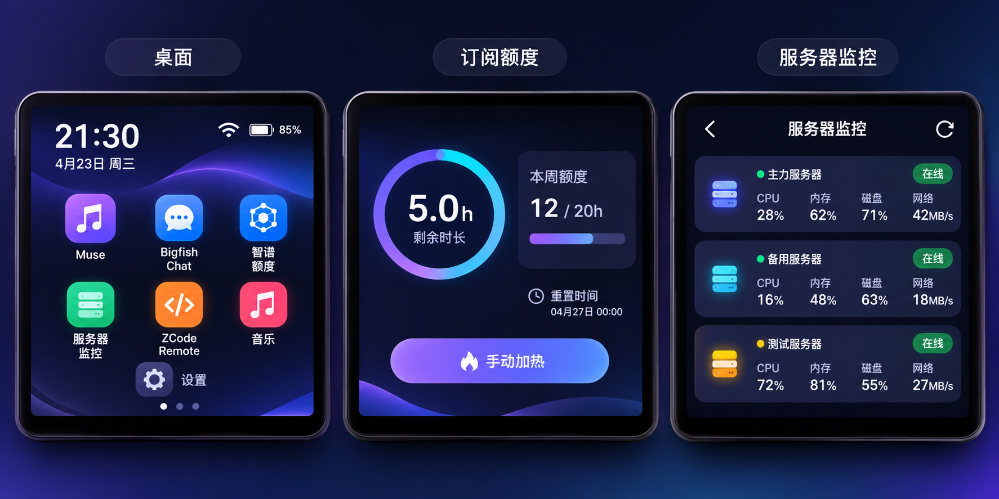
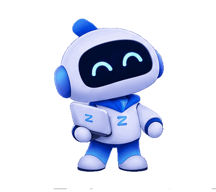

# Waveshare ESP32-S3 33969 AI Gadget — 项目开发计划

> 项目仓库建议：`waveshare-esp32-s3-33969-ai-gadget`  
> 目标硬件：Waveshare ESP32-S3-Touch-AMOLED-2.16（SKU 33969）  
> 文档状态：规划稿；硬件驱动、订阅接口和第三方服务均需按本文的验证规则逐项验收  
> 版本：v1.1（2026-11-14 v1.3 修订：固件基线回到自研，原厂系统仅作
> 交互范式学习——见 ADR-008）  

> **⚠️ 方向修订（2026-11-14，ADR-007→ADR-008）**：设备到手实测出厂
> 系统体验完整。官方仓库审查（FACTORY_REVIEW.md）确认出厂固件源码
> 未公开。**最终路线（ADR-008）：固件基线回到自研**——esp-brookesia
> 与出厂系统仅作交互范式学习（四宫格/左右分页/上滑退出/任务列表/
> pause-resume 生命周期语义），不引入框架依赖。新增：三顶部按键
> 短按/长按（PWR 长按开关机不动）、配网以 Web 二维码为主 + 保留
> 小屏 Wi-Fi 连接。应用清单/数据链路（Bridge/订阅/AstrBot）/后台
> 策略表全部继续有效。Bridge/Web/Simulator 三件套不受影响。


------------------------------------------------------------------------

## 0. 阅读说明与重要约定

本项目是针对 **Waveshare ESP32-S3-Touch-AMOLED-2.16（33969）**
的社区定制项目，不是 Waveshare
官方固件，也不是把某个现成语音助手固件简单换皮。

本文中的信息分为三类：

- **官方公开能力**：官方仓库、官方文档明确提供的硬件、SDK 或 API。
- **社区观察接口**：从公开社区实现中整理出的控制台接口，可能不是供应商承诺长期兼容的公共
  API。
- **待验证项**：必须用实际账号、当前套餐和真机验证，不能仅凭接口路径就视为可用。

特别注意：

1.  订阅额度接口与模型 API
    是两回事。订阅额度接口通常读取账户/套餐用量，不代表可用于发起模型请求。
2.  不同地区、套餐、账号类型可能返回不同字段。
3.  不把浏览器 Cookie、OAuth Token、API Key 写入固件、日志、Git
    或二维码。
4.  对未公开的控制台接口，采用可关闭的
    Adapter，保留手动刷新和错误提示；不把它当成稳定官方 SLA 接口。
5.  图片和吉祥物是本项目的设计草案，不代表供应商官方商标或官方视觉资产。

------------------------------------------------------------------------

# 1. 项目目标与产品定位

## 1.1 产品定位

打造一台基于 ESP32-S3 的多应用 AI Gadget：

- 设备端提供桌面、App 切换、语音交互、状态查看和通知。
- 手机浏览器负责首次配网和常用设置。
- PC 浏览器负责完整管理、监控、日志和复杂配置。
- Go Bridge 负责云端 API、第三方服务、凭据管理和数据聚合。
- ESP32 负责硬件控制、UI、音频、存储和轻量网络通信。

它不是 Android 式多任务系统。第一版采用“一个业务 App 前台运行 +
系统服务常驻”的资源策略。

## 1.2 第一版明确目标

1.  适配 33969 的 AMOLED、触摸、音频、TF、PMU、RTC、IMU。
2.  建立 Launcher、App Manager 和统一系统服务。
3.  建立 ESP32 本地 Web 管理后台与 SoftAP 首次配网。
4.  建立 Go Bridge，统一接入 AI 和第三方订阅/监控服务。
5.  支持 Muse、小智、大肥鱼 Chat、智谱额度、ZCode Remote、Komari 监控。
6.  支持 TF 本地音乐和文件管理。
7.  第一版只提供 **HTTP CONNECT 代理传输配置**，不内置
    VMess/VLESS/V2Ray/Clash 客户端。
8.  使用 PC Simulator 和 Wokwi 提前开发；真机到手后验证板级驱动和功耗。

## 1.3 非目标

第一版不做：

- 动态下载安装 App。
- ESP32 本地大模型推理。
- V2Ray / sing-box / Clash / Xray 客户端。
- 全局透明代理。
- 全天候唤醒词监听。
- 多业务 App 同时常驻运行。
- 跨 App 后台混音或后台音乐播放。
- 云端多租户设备管理平台。

------------------------------------------------------------------------

# 2. 目标硬件与官方资料

## 2.1 硬件规格

| 项目       | 目标规格                                        |
|------------|-------------------------------------------------|
| 开发板     | Waveshare ESP32-S3-Touch-AMOLED-2.16            |
| SKU        | 33969                                           |
| MCU        | ESP32-S3R8                                      |
| CPU        | 双核 Xtensa LX7，最高 240MHz                    |
| PSRAM      | 8MB                                             |
| Flash      | 16MB                                            |
| 显示       | 2.16 英寸 AMOLED，480×480                       |
| 显示控制器 | CO5300，QSPI                                    |
| 触摸       | CST9220 电容触摸                                |
| 音频       | ES8311 Codec + ES7210 ADC                       |
| 麦克风     | 双麦克风设计，带回声消除相关电路                |
| PMU        | AXP2101                                         |
| IMU        | QMI8658                                         |
| RTC        | PCF85063                                        |
| TF         | MicroSD / TF 卡槽                               |
| 无线       | 2.4GHz Wi-Fi、Bluetooth LE                      |
| 电池       | 3.7V 电池接口，实际电池容量以购买版本和实物为准 |

官方硬件文档列出了外设、接口及引脚信息。实际开发必须以原理图、BSP
版本和真机测量为准。

## 2.2 官方硬件仓库与文档

| 资源                    | 链接                                                                                                    | 用途                                 |
|-------------------------|---------------------------------------------------------------------------------------------------------|--------------------------------------|
| Waveshare 官方 GitHub   | https://github.com/waveshareteam/ESP32-S3-Touch-AMOLED-2.16                                             | 官方示例、BSP 说明、原理图与固件资源 |
| 官方 Wiki               | https://docs.waveshare.com/ESP32-S3-Touch-AMOLED-2.16                                                   | 硬件说明、开发指南                   |
| 官方资源页              | https://docs.waveshare.com/ESP32-S3-Touch-AMOLED-2.16/Resources-And-Documents                           | 原理图、数据手册、相关开源项目       |
| ESP-IDF 开发指南        | https://docs.waveshare.com/ESP32-S3-Touch-AMOLED-2.16/ESP-IDF                                           | 官方 ESP-IDF 示例                    |
| ESP-Brookesia 示例说明  | https://github.com/waveshareteam/ESP32-S3-Touch-AMOLED-2.16/blob/main/docs/brookesia.md                 | 官方丰富 UI 示例说明                 |
| 组件兼容说明            | https://github.com/waveshareteam/ESP32-S3-Touch-AMOLED-2.16/blob/main/docs/components.md                | BSP 和组件依赖                       |
| 官方示例目录            | https://github.com/waveshareteam/ESP32-S3-Touch-AMOLED-2.16/tree/main/examples/esp-idf                  | ESP-IDF 工程入口                     |
| 官方 `03_esp-brookesia` | https://github.com/waveshareteam/ESP32-S3-Touch-AMOLED-2.16/tree/main/examples/esp-idf/03_esp-brookesia | 桌面、状态栏、导航和 App 结构参考    |
| 官方发布页              | https://github.com/waveshareteam/ESP32-S3-Touch-AMOLED-2.16/releases                                    | 官方示例包和版本                     |

官方仓库当前列出的 ESP-IDF 示例测试版本包括 5.5.5 和
6.0.2；不要仅凭该信息自行选择版本，初始化时应以目标示例的
`README`、组件依赖和 CI 实际构建结果为准。

## 2.3 官方示例采用策略

优先研究并复用：

1.  `01_AXP2101`：电源管理和电池相关读取。
2.  `02_lvgl_demo_v9`：LVGL 显示与刷新。
3.  `03_esp-brookesia`：手机风格 UI、App 注册、导航和手势。
4.  `04_Immersive_block`：QMI8658 姿态传感器。
5.  `05_Spec_Analyzer`：音频采集和频谱展示。

`03_esp-brookesia` 是产品 UI
的主要参考起点，但不是完整的本项目系统。保留官方 BSP
的边界，不要在尚未确认等价实现前随意删减其依赖。

------------------------------------------------------------------------

# 3. 开源仓库与文档清单

## 3.1 固件、芯片和 UI

| 项目              | 仓库/文档                                                                                | 本项目用途            |
|-------------------|------------------------------------------------------------------------------------------|-----------------------|
| ESP-IDF           | https://github.com/espressif/esp-idf                                                     | 固件基础框架          |
| ESP-IDF 官方文档  | https://docs.espressif.com/projects/esp-idf/                                             | 构建、网络、存储、OTA |
| ESP-Brookesia     | https://github.com/espressif/esp-brookesia                                               | 手机式 UI 框架参考    |
| LVGL              | https://github.com/lvgl/lvgl                                                             | 设备图形 UI           |
| LVGL 官方文档     | https://docs.lvgl.io/                                                                    | UI 控件、布局、动画   |
| LVGL PC Simulator | https://github.com/lvgl/lv_port_pc_vscode                                                | Mac 上运行 LVGL UI    |
| Wokwi             | https://wokwi.com/                                                                       | 在线 ESP32 仿真       |
| Wokwi ESP32 文档  | https://docs.wokwi.com/guides/esp32                                                      | ESP32 仿真说明        |
| ESP32-S3 QEMU     | https://docs.espressif.com/projects/esp-idf/en/stable/esp32s3/api-guides/tools/qemu.html | 固件/CPU 辅助仿真     |

## 3.2 AI 语音与聊天

| 项目            | 仓库/文档                                                            | 本项目用途                                   |
|-----------------|----------------------------------------------------------------------|----------------------------------------------|
| Muse Gadget SDK | https://github.com/facebookincubator/muse-gadget-sdk                 | Muse 设备 SDK，独立适配                      |
| Muse ESP32 说明 | https://github.com/facebookincubator/muse-gadget-sdk/tree/main/esp32 | SDK 构建、设备适配要求                       |
| 小智 ESP32      | https://github.com/78/xiaozhi-esp32                                  | 小智协议、音频和 UI 参考                     |
| 小智官方站      | https://xiaozhi.me/                                                  | 服务与设备配置入口                           |
| ESP-SR          | https://github.com/espressif/esp-sr                                  | 后续本地唤醒/VAD 能力研究，不列入 MVP 必需项 |

**Muse 版本注意：** 当前 Muse Gadget SDK 的 ESP32 文档要求 ESP-IDF
6.0.3，并明确要求核对 `devices/` 中的板卡支持清单。33969 是否已被当前
SDK 正式支持必须检查后再决定集成方式。不要把 Muse SDK 的 IDF
版本要求强行合并到 Waveshare 主工程，先做独立构建验证。

## 3.3 服务器监控和后端

| 项目        | 仓库/文档                                         | 本项目用途               |
|-------------|---------------------------------------------------|--------------------------|
| Komari      | https://github.com/komari-monitor/komari          | 服务器监控服务端         |
| Komari 文档 | https://github.com/komari-monitor/komari-document | API 和部署文档           |
| Go          | https://go.dev/                                   | Bridge                   |
| Gin         | https://github.com/gin-gonic/gin                  | HTTP API（备选）         |
| Chi         | https://github.com/go-chi/chi                     | 轻量 HTTP Router（备选） |

Komari API 路径以部署版本的文档和服务端代码为准。历史讨论中的
`/api/nodes`、`/api/recent/{uuid}`、`/api/records/load`
仅作为排查线索，实施前必须对照当前版本确认，不应直接视为稳定公共 API。

## 3.4 Web 前端

| 项目         | 链接                                   | 用途               |
|--------------|----------------------------------------|--------------------|
| Vue 3        | https://github.com/vuejs/core          | 前端框架           |
| Vue 文档     | https://vuejs.org/                     | 官方文档           |
| Vite         | https://github.com/vitejs/vite         | 构建工具           |
| TypeScript   | https://www.typescriptlang.org/        | 类型系统           |
| Pinia        | https://github.com/vuejs/pinia         | 状态管理           |
| Tailwind CSS | https://tailwindcss.com/               | 样式系统           |
| ECharts      | https://github.com/apache/echarts      | 监控图表，按需引入 |
| QRCode       | https://github.com/soldair/node-qrcode | 二维码生成         |

------------------------------------------------------------------------

# 4. 总体系统架构

## 4.1 三个工程

``` text
                    ESP32 AI Gadget
                           |
          +----------------+----------------+
          |                |                |
       Firmware          Web UI          Go Bridge
          |                |                |
     LVGL / FreeRTOS    Vue 3 / TS       REST / WebSocket
          |                |                |
     System Services   Device HTTP API    Provider Adapters
          |                |                |
     Hardware HAL      ESP32 HTTP       AI / Quota / Komari
          |                |                |
       33969 Board  <------+--------------> External Services
```

## 4.2 Firmware 分层

``` text
firmware/
├── main/
├── apps/                        # 业务 App（ADR-005：三 AI 独立入口 + 共用壳）
│   ├── launcher/
│   ├── assistant/               # ★ 共用聊天 UI（chat_view / message_list /
│   │                           #   companion_renderer / voice_panel）
│   ├── muse/                    # Muse 适配（官方 SDK）
│   ├── bigfish/                 # 大肥鱼适配（Model Router，可切 N 模型人设）
│   ├── xiaozhi/                 # 小智适配（小智协议）
│   ├── subscription/            # 订阅中心（多 Provider 聚合）
│   ├── zcode_remote/
│   ├── weather/                 # 天气（新增）
│   ├── server_monitor/          # Komari 监控
│   ├── music_player/
│   ├── file_manager/
│   └── settings/
└── components/
    ├── app_manager/
    ├── assistant_core/          # ★ 公共助手接口（状态事件/消息抽象）
    ├── companion_engine/        # ★ 公共角色动画引擎（统一状态→资源映射）
    ├── display_manager/
    ├── touch_manager/
    ├── audio_manager/
    ├── voice_session/
    ├── network_manager/
    ├── storage_manager/
    ├── power_manager/
    ├── notification_service/
    ├── device_config/
    ├── web_server/
    ├── wifi_provisioning/
    ├── proxy_transport/
    └── hardware/
```

## 4.3 运行模型

- 系统服务常驻。
- 一个业务 App 前台运行。
- 非前台 App 释放音频、网络轮询和大块临时内存。
- App 可以保存轻量状态，重新进入时恢复。
- 后台监控由 Go Bridge 执行，设备只接收摘要和通知。
- 不为每个 App 单独创建硬件驱动实例。

------------------------------------------------------------------------

# 5. App 产品设计

## 5.1 App 总览

| App            | 功能                          | 实现方式           | 优先级 |
|----------------|-------------------------------|--------------------|--------|
| Launcher       | 桌面、状态栏、App 入口        | —                  | P0     |
| Settings       | Wi-Fi、显示、音频、电源、存储 | —                  | P0     |
| Subscription   | 订阅中心（多 Provider 聚合）  | Bridge quota 域    | P1     |
| ZCode Remote   | Agent 会话与待确认状态        | Bridge zcode 域    | P1     |
| Server Monitor | Komari 多服务器监控           | Bridge komari 域   | P1     |
| 大肥鱼         | 通用 AI 聊天，可切模型/人设   | Bigfish Adapter    | P1     |
| Muse           | Muse 专属 AI 伙伴             | Muse Adapter(SDK)  | P2     |
| 小智           | 独立语音 AI 助手              | Xiaozhi Adapter    | P2     |
| Weather        | 天气                          | Bridge 天气源      | P3     |
| Music Player   | TF 卡本地音乐                 | —                  | P2     |
| File Manager   | TF 卡文件管理                 | —                  | P2     |

> 三个 AI App（Muse/大肥鱼/小智）共用一套 Assistant UI 与 Companion
> Engine，服务接入各自适配（ADR-005）；音频链路统一由 Audio Manager
> 独占管理（同一时刻仅一个助手占用，ADR-003）。
>
> **会话与角色（PRODUCT_SPEC v0.2，ADR-006）**：大肥鱼=多角色聊天
> （角色预设/切换/独立会话空间）；会话历史统一存 Bridge（设备只存
> 最近列表+缓存）；上下文压缩系统自动（摘要+最近 N 轮，不删历史）；
> 小智第一版仅展示当前 Agent（切换待官方接口验证）。设置分层为
> 首页+四分类（显示声音/网络连接/服务管理/设备信息）。

## 5.2 Launcher

- 480×480 主屏。
- 时间、日期、Wi-Fi、电池状态。
- 网格 App 图标。
- 页面指示器。
- 点击进入 App。
- 统一返回手势。
- 通知入口。
- 简单快捷设置。

## 5.3 Bigfish Chat

- 文字对话。
- 流式输出。
- 模型选择。
- 语音转文字。
- AI 语音回答。
- 会话列表和历史摘要。
- 远端 Model Router。

ESP32 不保存 Provider API Key。所有密钥由 Bridge 管理。

语音链路（后续）：设备录音 → Bridge ASR → chat/completions → Bridge TTS
→ 设备播放。复用系统级 Voice Session 服务，不使用小智协议，会话历史
统一保存在 Bridge。

## 5.4 Muse AI

- Muse SDK 单独验证。
- 验证 BLE 配对和 Wi-Fi 配网。
- 验证 Noise 会话。
- 验证语音输入和输出。
- 适配 Audio Manager。
- 默认直连。
- 第一版只提供可选 HTTP CONNECT 代理。
- 不实现 V2Ray 客户端。

## 5.5 Xiaozhi AI

- 独立业务 App，与 Muse App 对称：每个第三方语音生态一个
  App，只带各自的 UI 和协议客户端。
- 对接小智协议/服务（WS/MQTT、设备激活）。
- 复用系统级 Voice Session 服务（采集/播放/VAD/opus），不私有化
  音频硬件。
- 第一版优先语音输入、AI 回复、语音播放。
- 不直接接管硬件驱动。
- 先确认当前小智主线 IDF 版本与 Waveshare BSP
  的兼容性，再决定是组件集成还是独立移植。

## 5.6 Zhipu Quota

显示：

- 套餐名称。
- 5 小时额度使用百分比。
- 5 小时重置时间。
- 每周额度使用百分比。
- 每周重置时间。
- 月度工具额度（接口有返回时才显示）。
- 最近刷新时间。
- 请求错误状态。

预热：

- 用户手动点击。
- 二次确认。
- 显示预计请求行为。
- 发起一次明确的轻量请求。
- 记录请求前后额度和时间。
- 检查周额度和套餐限制。
- 不自动预热、不后台消耗。

预热不等于重置整个 5 小时窗口；必须按供应商真实窗口规则解释。

## 5.7 ZCode Remote

- 会话列表。
- Agent 名称。
- 项目名称。
- 运行状态。
- 等待确认数量。
- 已完成数量。
- 失败数量。
- 最近活动时间。
- 后续支持查看会话详情和有限远程操作。

## 5.8 Server Monitor

- 多服务器列表。
- 在线/离线。
- CPU、内存、磁盘。
- 网络上下行。
- 运行时间。
- 最后上报时间。
- 详情图表。
- 手动刷新。
- 前台 30～60 秒刷新。
- 离开页面停止设备侧轮询。
- Bridge 负责外部数据采集和告警。

## 5.9 Music Player / File Manager

Music Player：

- TF 音乐扫描。
- 播放/暂停。
- 上一首/下一首。
- 音量控制。
- 播放列表。
- 第一版不跨 App 后台播放。

File Manager：

- 浏览目录。
- 文件信息。
- 创建文件夹。
- 删除前确认。
- 音乐、录音、日志目录入口。

------------------------------------------------------------------------

# 6. 订阅额度监控：Provider 接口清单

## 6.1 统一原则

所有订阅额度 Provider 统一实现：

``` go
type QuotaProvider interface {
    ID() string
    DisplayName() string
    Capabilities() ProviderCapabilities
    FetchQuota(ctx context.Context, account AccountRef) (*QuotaSnapshot, error)
}
```

统一数据结构建议：

``` go
type QuotaSnapshot struct {
    ProviderID  string
    AccountID   string
    PlanName    string
    FetchedAt   time.Time
    Status      string
    Windows     []QuotaWindow
    Credits     []CreditBalance
    RawVersion  string
}

type QuotaWindow struct {
    ID             string
    Label          string
    WindowSeconds  int64
    Used           *float64
    Limit           *float64
    Remaining       *float64
    UsedPercent     *float64
    RemainingPct    *float64
    ResetAt         *time.Time
    Unit            string
    IsUnlimited     bool
    SourceField     string
}
```

规则：

- `UsedPercent` 和 `RemainingPct`
  分开存储，不能把已用百分比误显示成剩余百分比。
- 没有返回的数据保持 `nil`，不能伪造为 0。
- 重置时间保留原始时区/时间戳并统一转换 UTC 存储。
- 原始响应只在调试模式脱敏保存。
- 每个 Provider 单独版本化和测试。
- 供应商接口异常时保留上一次成功数据，同时显示数据过期状态。
- UI 显示“最后更新时间”，避免用户误认为是实时数据。

## 6.2 Provider 接口可信度分级

| 等级 | 含义                                            | 实施策略                              |
|------|-------------------------------------------------|---------------------------------------|
| A    | 官方公开 API                                    | 优先集成                              |
| B    | 官方 CLI/OAuth 提供的配额接口，但非通用公开 API | 通过官方 CLI/OAuth 授权，做好版本检测 |
| C    | 社区已观察到的控制台内部接口                    | 独立 Adapter、默认关闭或用户明确启用  |
| D    | 只能从本地使用记录估算                          | 明确标注“估算”，不得冒充官方余额      |

## 6.3 智谱 GLM Coding Plan（优先实现）

社区项目 `dsh-provider-balance`、CodexBar
等记录了智谱订阅控制台正在使用的额度接口。它们不是智谱公开 API
文档承诺的稳定接口，需按 C 级处理。

参考：

- 社区实现：https://github.com/aka-danielZhang/dsh-provider-balance
- CodexBar Provider
  文档：https://github.com/steipete/CodexBar/blob/main/docs/zai.md
- 智谱开放平台：https://open.bigmodel.cn/
- 智谱 API 文档：https://docs.bigmodel.cn/

### 额度查询接口

国内：

``` http
GET https://open.bigmodel.cn/api/monitor/usage/quota/limit
Authorization: Bearer <BIGMODEL_API_KEY>
```

国际站：

``` http
GET https://api.z.ai/api/monitor/usage/quota/limit
Authorization: Bearer <ZAI_API_KEY>
```

套餐信息：

``` http
GET https://open.bigmodel.cn/api/biz/subscription/list
Authorization: Bearer <BIGMODEL_API_KEY>
```

国际站需要按实际账号区域验证对应
Host，不应把国内接口域名硬编码到全球账号。

### 字段映射

社区观察到 `data.limits[]` 可能包含：

- `type = TOKENS_LIMIT`
- `unit = 3`、`number = 5`：5 小时窗口
- `unit = 6`、`number = 1`：每周窗口
- `percentage`：已使用百分比
- `nextResetTime`：Unix 毫秒时间戳
- `type = TIME_LIMIT`：工具/搜索等时间或月度额度，按实际字段解析

注意：

- `percentage` 是已用比例时，UI 剩余比例应为 `100 - percentage`。
- `nextResetTime` 是毫秒，不是秒。
- `TIME_LIMIT` 不能和 Token Plan 的 5 小时/周额度混为一谈。
- 套餐接口与额度接口应分别请求，任意一个失败不应让另一个成功数据丢失。

### 示例请求（Go）

``` go
req, _ := http.NewRequestWithContext(
    ctx,
    http.MethodGet,
    baseURL+"/api/monitor/usage/quota/limit",
    nil,
)
req.Header.Set("Authorization", "Bearer "+apiKey)
req.Header.Set("Accept", "application/json")
```

### 智谱实现要求

- `ZhipuQuotaProvider` 独立模块。
- 国内/国际 Host 可配置。
- Token 只保存在 Bridge。
- UI 提供手动刷新。
- 默认刷新周期 5～15 分钟，避免频繁请求。
- 预热必须由用户主动发起，单独记录。
- 先使用 Mock JSON 写解析单测，再用真实账号验证。

## 6.4 OpenAI ChatGPT / Codex 订阅

需要区分：

- ChatGPT / Codex 订阅额度。
- OpenAI API Platform 的组织用量和费用。

两者不是同一套计费系统。

### Codex 订阅额度（社区观察接口，C 级）

社区工具 CodexBar 记录了以下接口：

``` http
GET https://chatgpt.com/backend-api/wham/usage
Authorization: Bearer <OAuth access token>
ChatGPT-Account-Id: <account_id>
User-Agent: codex-cli
```

可选重置额度信息：

``` http
GET https://chatgpt.com/backend-api/wham/rate-limit-reset-credits
```

社区观察到的字段包括：

- `plan_type`
- `rate_limit.primary_window.used_percent`
- `rate_limit.primary_window.reset_at`
- `rate_limit.primary_window.limit_window_seconds`
- `rate_limit.secondary_window.used_percent`
- `rate_limit.secondary_window.reset_at`
- `credits`

参考：

- https://github.com/steipete/CodexBar/blob/main/docs/codex.md
- https://github.com/steipete/CodexBar/blob/main/docs/codex-oauth.md

重要：

- 这是 ChatGPT/Codex Web/OAuth 内部接口，不是 OpenAI
  面向所有开发者承诺的公共订阅 API。
- OAuth Token 应由用户授权流程或官方 Codex CLI 提供，不能让用户把
  `auth.json` 明文上传到 ESP32。
- Bridge 不应擅自刷新或覆写官方 CLI 的凭据文件。
- 接口变更、账号区域和套餐差异都必须处理。

### OpenAI API Platform（官方组织用量 API）

如果用户配置的是 API 组织管理员密钥，可读取组织 API 使用量和费用：

``` http
GET https://api.openai.com/v1/organization/costs
GET https://api.openai.com/v1/organization/usage/completions
```

它们不是 ChatGPT Plus/Pro/Codex 订阅额度。

官方文档：

- https://platform.openai.com/docs/api-reference/usage
- https://platform.openai.com/docs/api-reference/organization

## 6.5 Anthropic Claude / Claude Code

Claude Code 订阅额度与 Anthropic API Console 费用也要区分。

### Claude Code 订阅

目前不把某个社区抓取的 Web 内部路径定义为稳定公共 API。

优先顺序：

1.  用户主动在官方 Claude Code CLI 中查看 `/usage`。
2.  研究官方 CLI/OAuth 可用的、明确授权的只读用量能力。
3.  如果未来有官方公开订阅额度 API，再新增 API Adapter。

不建议：

- 从用户浏览器导出长期 Cookie 上传到设备。
- 在固件中保存 Anthropic Web Session。
- 依赖未经公开承诺的内部 API 作为核心功能。

### Anthropic API 组织用量（官方 Admin API）

如果用户有组织管理员密钥，可读取 API 消耗：

``` http
GET https://api.anthropic.com/v1/organizations/cost_report
GET https://api.anthropic.com/v1/organizations/usage_report/messages
```

这属于 API 组织用量，不等于 Claude Pro/Max 订阅的消息额度。

参考：

- https://docs.anthropic.com/en/api/administration-api
- https://github.com/steipete/CodexBar/blob/main/docs/claude.md

## 6.6 Google Gemini CLI / Gemini Code Assist

### Gemini CLI OAuth 配额（内部接口观察，C 级）

社区实现记录：

``` http
POST https://cloudcode-pa.googleapis.com/v1internal:retrieveUserQuota
Authorization: Bearer <Google OAuth access token>
Content-Type: application/json

{
  "project": "<projectId>"
}
```

套餐/项目能力探测：

``` http
POST https://cloudcode-pa.googleapis.com/v1internal:loadCodeAssist
Authorization: Bearer <Google OAuth access token>
Content-Type: application/json
```

社区观察到的字段：

- `buckets[].remainingFraction`
- `buckets[].resetTime`
- `buckets[].modelId`

参考：

- https://github.com/steipete/CodexBar/blob/main/docs/gemini.md

重要兼容性说明：

- 这是 Gemini CLI 使用的内部配额接口，不应视为长期稳定的公共 API。
- Google 不同账号层级、Workspace、Code Assist Standard/Enterprise
  的授权路径不同。
- 社区实现记录了 2026 年消费级账号 OAuth 路径调整，不能假设 Gemini CLI
  的同一接口适用于所有 AI Pro/Ultra 订阅。
- 官方 Gemini Code Assist
  配额说明：https://cloud.google.com/gemini/docs/quotas
- 如果无法获得个人订阅的可靠额度数据，UI
  应显示“暂不支持查询”，不能伪造百分比。

## 6.7 Kimi Code

社区实现记录了相对清晰的 Coding Plan 用量接口，优先使用 API Key 路径。

中国区：

``` http
GET https://api.kimi.com/coding/v1/usages
Authorization: Bearer <KIMI_CODE_API_KEY>
```

国际区：

``` http
GET https://api.kimi.ai/coding/v1/usages
Authorization: Bearer <KIMI_CODE_API_KEY>
```

社区观察到的响应结构示例：

``` json
{
  "usage": {
    "limit": "2048",
    "used": "214",
    "remaining": "1834",
    "resetTime": "2026-01-09T15:23:13Z"
  },
  "limits": [
    {
      "window": {
        "duration": 300,
        "timeUnit": "TIME_UNIT_MINUTE"
      },
      "detail": {
        "limit": "200",
        "used": "139",
        "remaining": "61",
        "resetTime": "2026-01-06T13:33:02Z"
      }
    }
  ]
}
```

可解析：

- 月度/总量池。
- 5 小时限流窗口。
- 每周额度（接口实际返回时）。
- 重置时间。
- 套餐等级（若响应包含）。

参考：

- https://github.com/steipete/CodexBar/blob/main/docs/kimi.md
- Kimi Code Console：https://www.kimi.com/code/console
- 国际站：https://www.kimi.ai/code/console

注意：Kimi Code 与 Moonshot/Kimi Open Platform API
不是同一个计费体系，不能用普通 Open Platform API Key 查询 Coding Plan。

## 6.8 MiniMax Coding Plan

社区实现记录了 API Key 和控制台 Session 两种路径。

### 控制台额度接口（社区观察，C 级）

中国站当前观察到：

``` http
GET /backend/account/token_plan/remains_percent
```

旧路径：

``` http
GET /v1/api/openplatform/coding_plan/remains
```

Host
需要按账号所在区域和当前控制台请求确认，不能直接假定国内外域名完全相同。

社区文档记录的控制台入口：

- https://platform.minimax.cn/
- https://platform.minimaxi.com/

参考：

- https://github.com/steipete/CodexBar/blob/main/docs/minimax.md

### 实施要求

- 先验证 Coding Plan 专用 API Token 是否可读取额度。
- API Token 和普通模型调用 Key 区分保存。
- Web Session 作为可选路径，不作为设备端默认方式。
- 控制台响应字段变化时保留旧数据并显示错误。
- 5 小时和每周窗口分别解析。
- 若返回 unlimited 标记，不能强制转成 100% 或 0%。

## 6.9 阿里云百炼 Coding Plan

社区实现记录了控制台 RPC：

国际站 Host：

``` text
https://modelstudio.console.alibabacloud.com
```

中国站 Host：

``` text
https://bailian.console.aliyun.com
```

请求：

``` http
POST /data/api.json?action=zeldaEasy.broadscope-bailian.codingPlan.queryCodingPlanInstanceInfoV2&product=broadscope-bailian&api=queryCodingPlanInstanceInfoV2
```

可能的用量字段：

- `per5HourUsedQuota`
- `per5HourTotalQuota`
- `per5HourQuotaNextRefreshTime`
- `perWeekUsedQuota`
- `perWeekTotalQuota`
- `perWeekQuotaNextRefreshTime`
- `perBillMonthUsedQuota`
- `perBillMonthTotalQuota`
- `perBillMonthQuotaNextRefreshTime`

计算：

``` text
usedPercent = usedQuota / totalQuota * 100
```

鉴权可能涉及控制台 Session Cookie，也有 API Key
路径，但社区报告中国区部分账号可能返回 `ConsoleNeedLogin`，即 API Key
并不一定足够。

参考：

- https://github.com/steipete/CodexBar/blob/main/docs/alibaba-coding-plan.md
- 国际站 Coding
  Plan：https://modelstudio.console.alibabacloud.com/ap-southeast-1/?tab=globalset#/efm/coding_plan
- 国内站 Coding
  Plan：https://bailian.console.aliyun.com/cn-beijing/?tab=model#/efm/coding_plan

实现要求：

- 区分中国站和国际站。
- API Key 模式失败时不能悄悄伪装成成功。
- Cookie 模式必须明确告知用户其不稳定性。
- 只在 Bridge 保存凭据。
- 每个套餐窗口独立解析。

## 6.10 Qwen Cloud Token Plan

社区实现记录的个人 Token Plan 数据网关：

``` text
https://cs-data.qwencloud.com/data/api.json
?action=IntlBroadScopeAspnGateway
&product=sfm_bailian
```

相关 API 路径：

``` text
personal/api/v2/usage
personal/api/v2/subscription
personal/api/v2/quota-config
```

主要数据：

- 5 小时已用比例与重置时间。
- 每周已用比例与重置时间。
- 月度用量（接口返回时）。
- 当前套餐等级。
- 套餐对应额度上限。

鉴权：

- 当前社区实现主要依赖 Qwen Cloud / 阿里云控制台 Session Cookie。
- 需要 `sec_token` 等会话上下文。
- 当前不应把它标为 API Key 公共接口。

参考：

- https://github.com/steipete/CodexBar/blob/main/docs/qwen-cloud.md
- Qwen Cloud Token
  Plan：https://home.qwencloud.com/billing/subscription/token-plan-individual

## 6.11 其他值得预留的 Provider

| 供应商         | 数据源                                             | 建议                                         |
|----------------|----------------------------------------------------|----------------------------------------------|
| GitHub Copilot | GitHub OAuth / Copilot 用户额度接口                | 后续研究官方 OAuth 和用户额度 API            |
| Cursor         | 官方账户控制台会话数据                             | 暂不优先，需确认官方支持方式                 |
| Windsurf       | 控制台 Session / 本地数据                          | 后续评估                                     |
| OpenCode Go    | `GET https://opencode.ai/zen/go/v1/usage`，API Key | 可作为后续候选                               |
| sub2api        | `GET {baseURL}/v1/usage`，网关 API Key             | 如果使用该网关，可直接接入                   |
| LiteLLM        | `/key/info`、`/user/info` 或 `/team/info`          | 适用于自建网关预算，不是厂商订阅             |
| AWS Bedrock    | Cost Explorer / CloudWatch                         | 属于云 API 成本与用量，不是 Coding Plan 订阅 |

参考：

- CodexBar Provider
  总表：https://github.com/steipete/CodexBar/blob/main/docs/providers.md
- OpenCode Go：https://opencode.ai/
- sub2api：https://github.com/Wei-Shaw/sub2api
- LiteLLM：https://github.com/BerriAI/litellm

**实现优先级建议：**

1.  P1：智谱 GLM Coding Plan。
2.  P1：Kimi Code。
3.  P2：MiniMax Coding Plan。
4.  P2：阿里云百炼 Coding Plan。
5.  P2：Qwen Cloud Token Plan。
6.  P3：OpenAI Codex、Gemini、Claude Code（先做可行性和授权方式验证）。
7.  P3：Copilot、Cursor、Windsurf 等。

## 6.12 订阅接口的安全与维护

- 所有请求由 Go Bridge 发起，ESP32 不直连供应商管理 API。
- 账号凭据按 Provider 分开保存。
- 优先使用官方 API Key / OAuth，不优先使用 Cookie。
- 对控制台内部接口提供开关，默认关闭或明确提示“实验性”。
- 不将 Cookie、Authorization、API Key 写入日志。
- 不自动导出用户浏览器 Cookie。
- 不在固件 NVS 中保存供应商长期密钥。
- 所有 Adapter 使用独立 HTTP Client、超时、重试和限流。
- 保存脱敏后的最近成功快照。
- 每个 Provider 提供 JSON fixture 单测。
- 对未知响应结构返回 `unsupported_response`，不显示假数据。

------------------------------------------------------------------------

# 7. Muse 与 AI 服务接入

## 7.1 Muse SDK

官方仓库：

https://github.com/facebookincubator/muse-gadget-sdk

关键检查：

- SDK 当前要求的 ESP-IDF 版本。
- `esp32/devices/` 是否包含目标板。
- 显示和音频驱动是否可以复用 Waveshare BSP。
- Muse 配网流程是否与本项目 SoftAP/网页管理冲突。
- WebSocket/TLS/Noise 会话是否可通过目标网络建立。
- 语音输入输出是否能接入统一 Audio Manager。

Muse 不应成为系统启动的强依赖。Muse SDK 独立验证通过后再集成。

## 7.2 Muse 代理范围

第一版仅做 HTTP CONNECT 代理传输：

- 默认直连。
- 可选 HTTP CONNECT。
- 代理服务器地址。
- 代理端口。
- 可选 Basic Auth。
- 连接测试。
- 连接超时。
- 失败状态和错误日志。

不实现：

- VMess。
- VLESS。
- Trojan。
- Reality。
- Clash。
- sing-box。
- Xray。
- 节点订阅。

Muse 连接链路：

``` text
Muse App
   |
Network Manager
   |
   +-- Direct TCP
   |
   +-- HTTP CONNECT Tunnel
              |
              +-- TLS
                    |
                    +-- WebSocket
                          |
                          +-- Noise Session
```

注意：HTTP CONNECT 是 TCP 隧道，不是普通 HTTP 正向代理。必须验证 CONNECT
成功后 TLS、WebSocket Upgrade 和 Noise 握手均正常。

## 7.3 小智 SDK

官方仓库：

https://github.com/78/xiaozhi-esp32

当前上游版本的 IDF 需求可能高于 Waveshare
示例使用的版本。不要直接把整个小智工程复制到本项目；先确定协议层和音频层可复用的最小范围，再移植到本项目系统服务。

## 7.4 Bigfish Chat

Bridge 作为统一模型路由：

``` text
ESP32 Bigfish Chat
        |
        v
     Go Bridge
        |
        v
    Model Router
        |
   +----+----+-----+------+
   |         |     |      |
DeepSeek   Doubao Zhipu  Local
```

功能：

- 多 Provider 配置。
- 默认模型。
- 简单/普通/复杂任务模型选择（后续）。
- 流式响应。
- 语音输入/输出。
- 费用和调用日志（可选）。

------------------------------------------------------------------------

# 8. UI 设计规范与设计素材

## 8.1 设计方向

设备 UI：

- 深色 OLED 友好主题。
- 深蓝/黑色背景。
- 紫蓝渐变作为主强调色。
- 高对比文字。
- 轻量玻璃拟态卡片。
- 适度动效，避免持续高刷新。
- 触控目标足够大。
- 重要信息优先，不堆叠小字。

Web UI：

- 浅色/深色主题可选。
- 手机 Mobile First。
- PC 使用侧边栏和多列内容。
- 统一图标、状态色、圆角和间距。
- 订阅额度、监控和日志使用一致的数据卡片。

## 8.2 设备 UI 设计草图

<figure>

<figcaption aria-hidden="true">设备端 UI 概念图</figcaption>
</figure>

文件：`assets/ui/device-ui-concept.png`

该图是概念参考，不是可直接量产的像素级切图。实际开发需根据 480×480
屏幕、安全区域、字体和 LVGL 控件重新实现。

建议拆分为：

- Launcher 背景与 App 图标。
- 订阅额度环形进度组件。
- 周额度进度条。
- 服务器状态卡片。
- 状态栏图标。
- 通知徽标。
- 页面切换指示器。

## 8.3 设备 UI 页面清单

| 页面            | 主要元素                                |
|-----------------|-----------------------------------------|
| Launcher        | 时间、日期、Wi-Fi、电量、App 网格       |
| App Detail      | 标题、返回、主内容、操作区              |
| Zhipu Quota     | 5h 环形额度、周额度、重置时间、预热按钮 |
| Provider List   | 供应商图标、账号、套餐、状态            |
| Server Monitor  | 在线状态、CPU、内存、磁盘、网络         |
| Bigfish Chat    | 对话气泡、输入状态、语音按钮            |
| Muse            | 吉祥物、聆听/思考/回答状态              |
| Settings        | 网络、显示、音频、电源、存储            |
| Wi-Fi Provision | 热点信息、二维码、配网状态              |

## 8.4 供应商 Logo 规范

供应商 Logo
必须使用官方品牌资产或经许可的品牌图标，不使用图像生成模型仿造商标。

建议建立：

``` text
web/src/assets/providers/
├── zhipu.svg
├── openai.svg
├── anthropic.svg
├── google-gemini.svg
├── deepseek.svg
├── minimax.svg
├── qwen.svg
├── kimi.svg
├── alibaba-cloud.svg
├── github-copilot.svg
└── muse.svg
```

资源参考：

| 供应商              | 品牌/官方入口                                |
|---------------------|----------------------------------------------|
| 智谱 AI             | https://www.zhipuai.cn/                      |
| OpenAI              | https://openai.com/brand/                    |
| Anthropic           | https://www.anthropic.com/                   |
| Google              | https://about.google/brand-resource-center/  |
| DeepSeek            | https://www.deepseek.com/                    |
| MiniMax             | https://www.minimaxi.com/                    |
| Qwen                | https://qwen.ai/                             |
| Kimi                | https://www.kimi.com/                        |
| 阿里云              | https://www.alibabacloud.com/                |
| GitHub Copilot      | https://github.com/features/copilot          |
| Simple Icons 图标库 | https://github.com/simple-icons/simple-icons |

Logo 规范：

- 保留原始比例。
- 不随意改色或加描边。
- 浅色/深色背景分别检查可读性。
- 未找到可合法使用的 SVG 时使用供应商文字标识，不使用 AI
  生成的仿制商标。
- Logo 只作为服务标识，不暗示官方合作或背书。

## 8.5 Muse 动画吉祥物

项目内设计一个原创 AI 伙伴形象，供 Muse
页面、等待状态、语音反馈和通知使用。

概念素材：

<figure>

<figcaption aria-hidden="true">Muse AI 伙伴动画概念</figcaption>
</figure>

文件：`assets/mascots/muse-companion-concept.gif`

说明：

- 这是本项目原创风格的 AI 伙伴概念，不是 Muse 官方 Logo。
- 需要进一步统一角色外观、颜色、轮廓和表情。
- 最终固件应从 GIF 拆成低帧率小尺寸帧图，转为 LVGL 可用资源。
- 不建议在 480×480 屏幕上持续播放高分辨率 GIF。
- 设备端根据状态播放不同短动画。

Companion Engine 统一状态接口（ADR-005；与 voice_session 状态机同源）：
idle / listening / thinking / speaking / success / error——
服务适配器只发状态事件，UI 按当前 App 加载各自形象资源：

| App    | idle        | listening | thinking  | speaking    |
|--------|-------------|-----------|-----------|-------------|
| Muse   | 吉祥物 GIF  | 同左+波形 | 同左      | 同左+字幕   |
| 大肥鱼 | dsh 东张西望 | 同左      | dsh 写代码 | dsh 凭空生花 |
| 小智   | Q 版形象    | 同左+波形 | 同左      | 同左+字幕   |

（每角色资源独立；换形象/加动作不改聊天引擎。旧状态表保留作
单角色细化参考：）

资源格式建议：

- Web：GIF / WebP / Lottie（按浏览器支持决定）。
- ESP32：PNG 转 RGB565、Aseprite 导出帧图或 LVGL Image。
- 动画帧数：4～8 帧起步。
- 目标尺寸：设备端 96×96 或 128×128。
- 只在状态变化时播放，Idle 动画低频刷新。

## 8.6 设计素材后续任务

- [ ] 统一 App 图标风格。
- [ ] 生成每个业务 App 的独立图标。
- [ ] 完成 Muse 吉祥物正面、侧面和表情规范。
- [ ] 导出 Idle/Listening/Thinking/Speaking 动画。
- [ ] 制作 480×480 设备页面精细稿。
- [ ] 制作手机 Web 管理后台稿。
- [ ] 制作 PC Web 管理后台稿。
- [ ] 输出颜色、字体、间距和圆角 Design Tokens。
- [ ] 生成 LVGL 所需图片资源和压缩版本。

------------------------------------------------------------------------

# 9. Web 管理后台与首次配网

## 9.1 响应式布局

断点：

| 宽度        | 布局 |
|-------------|------|
| \< 640px    | 手机 |
| 640～1023px | 平板 |
| ≥ 1024px    | PC   |

手机：

- 单列卡片。
- 底部导航或抽屉。
- 表单分组折叠。
- 大触控按钮。
- 二维码入口优先。
- 兼容 iOS Safari、Android Chrome。

PC：

- 侧边栏。
- 多列仪表盘。
- 表格与筛选。
- 日志查看。
- 图表。
- 宽内容区域限制。

折叠屏按照实际窗口宽度和可用布局空间自适应，不单独依赖设备型号识别。

## 9.2 页面

``` text
Dashboard
├── Device Overview
├── Network
│   ├── Wi-Fi
│   └── HTTP Proxy
├── AI Services
│   ├── Providers
│   ├── Muse
│   ├── Xiaozhi
│   └── Bigfish Chat
├── Subscriptions
│   ├── Zhipu
│   ├── Kimi
│   ├── MiniMax
│   ├── Qwen
│   └── Others
├── Monitoring
│   ├── Komari
│   └── ZCode
├── Power
├── Audio
├── Storage
└── System
    ├── Apps
    ├── Logs
    └── Diagnostics
```

## 9.3 首次配网

使用 SoftAP + HTTP Server：

1.  首次启动时检测 NVS 中是否存在 Wi-Fi 配置。
2.  未配置则创建临时 SoftAP。
3.  屏幕显示 SSID、随机密码和二维码。
4.  手机连接热点。
5.  打开 `http://192.168.4.1`。
6.  扫描 Wi-Fi、输入密码。
7.  设备连接家庭 Wi-Fi。
8.  成功后关闭 SoftAP。
9.  屏幕显示局域网管理二维码。

二维码只包含 URL，不包含密码、API Key、Cookie 或 Token。

## 9.4 本地 Web API

``` text
GET    /api/device/status
GET    /api/device/config
PUT    /api/device/config

GET    /api/network/status
POST   /api/network/wifi/scan
POST   /api/network/wifi/connect

GET    /api/network/proxy
PUT    /api/network/proxy
POST   /api/network/proxy/test

GET    /api/system/apps
GET    /api/system/logs
GET    /api/storage/status
```

设备 Web Server 只处理设备本地配置。第三方云端凭据由 Bridge 管理。

------------------------------------------------------------------------

# 10. 网络和代理

## 10.1 Network Manager

统一管理：

- Wi-Fi 初始化、扫描、连接、重连。
- DNS。
- TCP/TLS。
- HTTP。
- WebSocket。
- 网络状态事件。
- 超时和取消。
- 代理传输。

## 10.2 第一版代理范围

第一版仅支持：

- Direct。
- HTTP CONNECT。
- 可选 Basic Auth。
- 代理连通性测试。
- Muse 单 App 使用代理。

不支持 V2Ray 节点订阅和 VMess/VLESS。

接口示意：

``` c
typedef enum {
    PROXY_MODE_DIRECT = 0,
    PROXY_MODE_HTTP_CONNECT
} proxy_mode_t;

typedef struct {
    proxy_mode_t mode;
    char host[128];
    uint16_t port;
    char username[64];
    char password[128];
} proxy_config_t;
```

实现注意：

- HTTP CONNECT 隧道建立后，再在隧道上执行 TLS。
- 代理认证信息不输出日志。
- 代理配置默认关闭。
- 连接失败不能伪装成直连成功。
- 代理配置只作用于 Muse 的网络传输，不改变全设备流量。

------------------------------------------------------------------------

# 11. 音频系统

## 11.1 音频与语音分层

``` text
Audio Manager（硬件层，系统服务）
├── Audio Input（I2S 采集 / ES7210）
├── Audio Output（I2S 播放 / ES8311）
└── 编解码与缓冲（opus、采样率、DMA、网络缓冲）

Voice Session（语音会话服务，系统级，引擎无关）
├── Push-to-Talk 模式
├── 连续对话模式（VAD 分段）
├── 会话状态机（Idle/Listening/Thinking/Speaking）
└── 独占租约（同一时刻只授予一个语音引擎）

语音引擎（业务 App，前台运行）
├── Xiaozhi App  → 小智协议，会话在小智服务端
├── Muse App     → Noise 会话，会话在 Muse 云端
└── Bigfish Chat → Bridge ASR + Chat + TTS，会话在 Bridge
```

分界规则：

- 语音引擎之间不共享会话历史，各引擎会话归属见上图。
- 语音引擎只通过 Voice Session 获取音频，不直接操作 I2S。
- ASR/TTS 属于 Bridge 的服务能力（Bigfish 语音链路），不是
  Audio Manager 的一部分。
- v2 可在 Voice Session 抽象上增加统一“语音助手壳”（引擎可
  切换）；v1 不做。

### Audio Manager 职责

- I2S 初始化。
- 麦克风采集。
- 音频播放。
- 采样率。
- 音量。
- DMA Buffer。
- 音频资源互斥。
- 网络音频缓冲。
- 错误恢复。

### Voice Session 职责

- 录音会话生命周期管理（开始/停止/取消）。
- 音频帧回调（opus 编码后的帧或 PCM，按引擎需求）。
- VAD 分段与静音判定。
- 播放队列与打断（barge-in）策略。
- 引擎独占租约与异常释放。

## 11.2 语音模式

A. Push-to-Talk：

- 按住开始录音。
- 松开结束。
- 上传音频。
- 播放 AI 回复。

B. 用户主动开启的连续对话：

- 主动进入监听。
- VAD 分段。
- 语音段结束后提交。
- AI 回复后继续监听。
- 用户主动退出。

第一版不做全天候唤醒词监听。

------------------------------------------------------------------------

# 12. 存储设计

## 12.1 存储位置

| 数据         | 存储      |
|--------------|-----------|
| Wi-Fi 配置   | NVS       |
| 设备设置     | NVS       |
| 固件         | Flash     |
| UI 必要资源  | Flash     |
| 音乐         | TF        |
| 聊天历史     | TF        |
| 录音         | TF        |
| 日志         | TF        |
| 大型缓存     | TF        |
| 实时音频缓冲 | RAM/PSRAM |

## 12.2 TF 目录

``` text
/tf
├── system/
│   ├── config/
│   ├── logs/
│   └── cache/
├── apps/
│   ├── bigfish_chat/
│   ├── zcode_remote/
│   ├── quota_monitor/
│   ├── xiaozhi/
│   └── muse/
├── media/
│   ├── music/
│   ├── recordings/
│   ├── images/
│   └── wallpapers/
└── downloads/
```

统一 Storage Manager。TF 卡未插入时，系统仍能启动，受影响 App
显示存储不可用。

------------------------------------------------------------------------

# 13. 电源管理

> 完整方案见 [docs/POWER_MANAGEMENT.md](docs/POWER_MANAGEMENT.md)
> （V1.0：设计原则/模块架构/网络·显示·音频·动画·CPU 策略/电源状态机/
> 资源锁/ZCode 会话策略/功耗测试 T01–T13/五阶段实施计划）。
> 本节保留摘要与关键决策。

## 13.1 电源状态

``` text
ACTIVE -> DIMMED -> SLEEP -> DEEP_SLEEP (later)
```

息屏选项：

- 15 秒
- 30 秒
- 1 分钟
- 2 分钟
- 5 分钟

唤醒：

- 触摸或按键。
- 首次触摸仅唤醒，不执行点击。
- 具体 GPIO/触摸中断唤醒能力需真机验证。

## 13.2 App 电源锁

需要持续联网的 App 可申请：

- Display Lock。
- Network Lock。

采用租约或引用计数，App 异常退出时自动释放，防止屏幕常亮或网络长期占用。

## 13.3 电池与充电（AXP2101）

板载 AXP2101 PMU（共享 I²C，地址 0x34 待验证，HARDWARE §2.6）提供
电压/电量/充电/USB 状态——**不走 GPIO 估算**。统一由 Power Manager
管理（`firmware/components/power_manager/`），App 不得直接访问 PMU。

**轮询策略**：正常 30s / 充电中 15s / 状态突变立即回调 / 低电触发通知。

**全局状态栏显示规则**（所有屏幕顶部 overlay，`ui_statusbar.c`）：

| 状态 | 显示 |
|------|------|
| 60–100% | 五档电池图标 + % |
| 10–19% | 低电色（WARN）+ % |
| 0–9% | 紧急色（ERR）+ % |
| 充电中 | 电池图标 + 绿色闪电 |
| USB 供电、未检到电池 | USB 图标（不显示虚假 100%） |

**设备信息页**：电源与电池卡（电压/电量/充电状态/USB），真机数值
由 Power Manager 采集；模拟器为演示值并标注。

**低电策略**（用户可关闭/调整）：

- < 15%：提醒充电（系统通知）。
- < 5%：节能策略——降亮度、缩短息屏、暂停高耗任务。
- 低电量自动息屏/降亮度，避免影响正常语音交互。

固件接口（bring-up 寄存器按数据手册核对）：

```c
typedef struct {
    bool battery_present;
    bool usb_connected;
    bool charging;
    int battery_percent;
    int battery_voltage_mv;
} battery_status_t;
esp_err_t battery_get_status(battery_status_t *status);
```

## 13.4 充电屏保（USB 供电态常亮策略，用户 2026-11-14 拍板）

**需求**：USB 连接充电器（充电中或已充满未断开）时屏幕**常亮**，但不得
让完整应用界面连续显示数小时（AMOLED 烧屏风险）。

**策略**：

| 触发 | 行为 |
|------|------|
| USB 在位（充电中/充满未拔）+ 界面 idle ≥ 2 分钟 | 进入充电屏保 |
| 屏保态 | 纯黑背景 + 亮度 ≤ 20% + 少量缓慢动态元素（时钟/电量/呼吸点，元素位置缓慢漂移分散像素负载） |
| 屏保态触摸/按键 | 回到正常界面与用户亮度（首次触摸仅唤醒） |
| 再次 idle ≥ 2 分钟 | 重新进入屏保 |
| USB 断开 | 恢复正常息屏策略（idle → DIMMED → SLEEP） |
| 无电池 + USB 供电 | 同样进屏保；电量显示 USB 图标（§13.3 规则） |

**设计要点**：常亮 ≠ 静态高亮画面。屏保动态元素避免固定亮区（呼吸/圆周
缓移而非常亮点），黑色像素 AMOLED 不发光。充电屏保由 Power Manager 的
USB 状态变化回调驱动，App 电源锁（§13.2）优先级高于屏保（如导航类 App
持锁时延迟进屏保）。

------------------------------------------------------------------------

# 14. 资源预算

## 14.1 PSRAM 目标预算

以下仅为初始预算，不是实测：

| 模块         |  预算 |
|--------------|------:|
| LVGL/UI      | 1.5MB |
| 音频缓冲     |   1MB |
| 网络缓冲     |   1MB |
| App 临时数据 |   1MB |
| 系统缓存     | 0.5MB |
| 预留         |   3MB |

内部 SRAM 单独统计，不能把 PSRAM 当作 DMA 和实时缓冲的万能替代。

## 14.2 显示缓冲

480×480 RGB565 单帧约 450KiB，双帧约 900KiB。

优先采用 LVGL 部分刷新和局部缓冲，避免不必要的双全屏缓存。

## 14.3 真机性能记录

必须记录：

- 内部 SRAM 剩余。
- PSRAM 剩余。
- 最大连续空闲块。
- CPU 占用。
- 固件大小。
- App 切换内存变化。
- 音频播放峰值内存。
- 网络断开恢复时间。
- 亮屏、息屏、联网和代理场景电流。
- 电池实际续航。

------------------------------------------------------------------------

# 15. Go Bridge 设计

## 15.1 目录

``` text
bridge/
├── cmd/gadget-bridge/
├── internal/
│   ├── api/
│   ├── config/
│   ├── device/
│   ├── events/
│   ├── storage/
│   ├── security/
│   ├── ai/
│   │   ├── router/
│   │   └── providers/
│   ├── conversations/         # 会话存储域（ADR-006）
│   ├── quota/
│   │   ├── zhipu/
│   │   ├── kimi/
│   │   ├── minimax/
│   │   ├── qwen/
│   │   ├── alibaba/
│   │   ├── openai/
│   │   ├── anthropic/
│   │   └── gemini/
│   ├── komari/
│   ├── zcode/
│   └── logger/
├── configs/
├── migrations/
└── go.mod
```

## 15.2 主要 API

``` text
GET    /api/v1/device/status
GET    /api/v1/device/config
PUT    /api/v1/device/config

GET    /api/v1/quota/providers
GET    /api/v1/quota/{provider}/snapshot
POST   /api/v1/quota/{provider}/refresh
POST   /api/v1/quota/zhipu/prewarm

GET    /api/v1/komari/nodes
GET    /api/v1/komari/nodes/{id}

GET    /api/v1/zcode/sessions
GET    /api/v1/zcode/sessions/{id}

POST   /api/v1/chat/completions
GET    /api/v1/events
```

`prewarm` 必须由用户交互触发，并在 Bridge
端再次校验账号、额度状态和幂等请求 ID。

## 15.3 数据存储

初期使用 SQLite：

- Provider 配置。
- 账号标签。
- 最近额度快照。
- 刷新时间。
- 错误状态。
- 操作记录。

敏感凭据加密存储，密钥由部署环境提供，不提交到 Git。

------------------------------------------------------------------------

# 16. 模拟器与开发环境

## 16.1 PC Simulator

主要开发 UI：

- Launcher。
- App 页面。
- 动画。
- 触摸交互。
- 订阅额度卡片。
- 服务器卡片。
- 设置页面。

## 16.2 Wokwi

辅助验证：

- ESP32-S3 固件启动。
- 部分 GPIO/I2C/SPI 行为。
- 基础网络逻辑。
- 串口日志。

Wokwi 不等于 33969 的完整虚拟板，不可据此宣布
CO5300、CST9220、ES8311、ES7210、AXP2101 已通过测试。

## 16.3 QEMU

用于支持范围内的固件调试。不能替代真实 AMOLED、触摸、音频和电源验证。

## 16.4 Mock 硬件层

``` text
Hardware Interface
       |
       +-- Real Adapter (33969)
       |
       +-- Mock Adapter (PC)
```

业务层不能因为运行在 PC Simulator 就引入另一套业务实现。

------------------------------------------------------------------------

# 17. 仓库目录结构

``` text
waveshare-esp32-s3-33969-ai-gadget/
├── firmware/
│   ├── main/
│   ├── apps/
│   ├── components/
│   ├── managed_components/
│   └── partitions/
├── bridge/
│   ├── cmd/
│   ├── internal/
│   ├── configs/
│   └── migrations/
├── web/
│   ├── src/
│   │   ├── api/
│   │   ├── assets/
│   │   │   └── providers/
│   │   ├── components/
│   │   ├── layouts/
│   │   ├── pages/
│   │   ├── router/
│   │   ├── stores/
│   │   └── styles/
│   └── package.json
├── simulator/
│   ├── lvgl-pc/
│   └── wokwi/
├── assets/
│   ├── ui/
│   ├── mascots/
│   ├── icons/
│   └── providers/
├── docs/
│   ├── PLAN.md
│   ├── HARDWARE.md
│   ├── ARCHITECTURE.md
│   ├── PROVIDER_APIS.md
│   ├── UI_DESIGN.md
│   ├── API.md
│   ├── DEVELOPMENT.md
│   ├── TESTING.md
│   └── DECISIONS.md
├── scripts/
├── README.md
├── .gitignore
└── LICENSE
```

------------------------------------------------------------------------

# 18. 开发阶段与验收

## Phase 0：项目初始化

- [ ] 阅读 Waveshare 官方仓库。
- [ ] 确认 BSP 版本。
- [ ] 确认 ESP-IDF 主版本。
- [ ] 检查官方 `03_esp-brookesia` 示例。
- [ ] 创建 Monorepo。
- [ ] 创建 Firmware 最小工程。
- [ ] 创建 Bridge 最小工程。
- [ ] 创建 Web 最小工程。
- [ ] 建立代码规范。
- [ ] 建立 CI 编译检查。

验收：三个子工程均能独立构建。

## Phase 1：PC UI

- [ ] LVGL PC Simulator 运行。
- [ ] 建立 480×480 主题。
- [ ] Launcher。
- [ ] App Manager。
- [ ] Mock Display/Touch/Audio/Power。
- [ ] 页面跳转和返回。
- [ ] 资源释放测试。

验收：PC 上可完整操作桌面和基础 App。

## Phase 2：Web 管理后台

- [ ] Vue 3 + TypeScript。
- [ ] 手机/PC 响应式。
- [ ] Dashboard。
- [ ] Wi-Fi 页面。
- [ ] 代理配置。
- [ ] 设备设置。
- [ ] 二维码配网流程原型。
- [ ] API Mock。
- [ ] 认证与脱敏。

验收：手机和 PC 都能完成模拟配置流程。

## Phase 3：Bridge

- [ ] Go HTTP API。
- [ ] WebSocket。
- [ ] SQLite。
- [ ] 配置加密。
- [ ] Provider 接口。
- [ ] 智谱 Adapter。
- [ ] Mock Provider。
- [ ] 额度快照和错误状态。

验收：通过 Mock JSON 完成端到端额度展示。

## Phase 4：订阅与监控 App

- [ ] 智谱额度。
- [ ] 手动预热。
- [ ] Kimi Code（可选）。
- [ ] MiniMax（可选）。
- [ ] Komari。
- [ ] ZCode Remote。

验收：接口异常、无额度、重置时间、未知字段均能正确呈现。

## Phase 5：AI Chat 与语音

- [ ] Bigfish Chat 文字。
- [ ] 流式响应。
- [ ] Audio Manager。
- [ ] 语音采集。
- [ ] TTS 播放。
- [ ] Muse 独立验证。
- [ ] Xiaozhi 独立验证。
- [ ] HTTP CONNECT 代理验证。

验收：文字和语音链路可稳定运行。

## Phase 6：33969 真机适配

- [ ] 显示初始化。
- [ ] 触摸。
- [ ] I2S。
- [ ] ES8311 播放。
- [ ] ES7210 采集。
- [ ] Wi-Fi。
- [ ] TF 卡。
- [ ] AXP2101。
- [ ] RTC。
- [ ] IMU。
- [ ] 触摸唤醒。
- [ ] 息屏。
- [ ] OTA 分区验证。

验收：真实设备能够稳定运行 MVP。

## Phase 7：优化

- [ ] 内存泄漏。
- [ ] CPU 和 PSRAM。
- [ ] 网络重连。
- [ ] 音频延迟。
- [ ] 电池功耗。
- [ ] 休眠策略。
- [ ] UI 帧率。
- [ ] Web 安全。
- [ ] OTA 回滚。
- [ ] 文档完善。

------------------------------------------------------------------------

# 19. 安全规范

- API Key 不进入 Firmware。
- Provider 密钥只存 Bridge。
- 不提交 `.env`、Cookie、OAuth Token、API Key。
- 日志统一脱敏。
- Web 管理 API 认证。
- 首次配网密码随机生成。
- 二维码不携带秘密。
- HTTP 管理入口仅限受控局域网；远程管理应走安全 Bridge 通道。
- 代理密码加密存储。
- 远程操作必须有权限边界和操作确认。
- 未公开接口必须可禁用。
- 不把本地使用估算显示成供应商官方额度。

------------------------------------------------------------------------

# 20. 设计与资源文件

本仓库的设计素材统一放在：

``` text
assets/
├── ui/
│   └── device-ui-concept.png
├── mascots/
│   └── muse-companion-concept.gif
├── icons/
└── providers/
```

当前素材：

- `assets/ui/device-ui-concept.png`：设备桌面、订阅额度和服务器监控概念图。
- `assets/mascots/muse-companion-concept.gif`：原创 AI
  伙伴动画草案，非官方 Muse 商标。

供应商官方品牌资产入口见第 8.4 节。不要用生成图片冒充真实供应商 Logo。

------------------------------------------------------------------------

# 21. 当前启动任务（给 Claude Code）

第一次执行不要直接开发全部 App。

请先完成以下任务：

1.  检查仓库当前文件结构。
2.  阅读 Waveshare 官方 GitHub 与 Wiki。
3.  阅读 `examples/esp-idf/03_esp-brookesia`。
4.  阅读 Muse SDK 的 ESP-IDF 版本和 `devices/` 支持列表。
5.  阅读小智当前主线的 IDF 版本要求。
6.  输出 `docs/HARDWARE.md`：整理 33969 外设、引脚、BSP 版本、待验证项。
7.  输出 `docs/ARCHITECTURE.md`：确定系统模块边界。
8.  初始化 Firmware、Bridge、Web 三个最小工程。
9.  初始化 LVGL PC Simulator。
10. 先实现模拟 Launcher，不接入真实业务 API。
11. 订阅接口先建立 Provider Adapter 和 Mock JSON，不要直接把
    Cookie/内部接口写死。
12. 所有无法验证的内容记录为 TODO，不得声称已通过测试。

完成每一步后运行构建或测试，并记录命令、结果和遗留问题。

------------------------------------------------------------------------

# 22. 参考资料与来源

硬件：

- https://github.com/waveshareteam/ESP32-S3-Touch-AMOLED-2.16
- https://docs.waveshare.com/ESP32-S3-Touch-AMOLED-2.16
- https://docs.waveshare.com/ESP32-S3-Touch-AMOLED-2.16/Resources-And-Documents

SDK：

- https://github.com/espressif/esp-idf
- https://github.com/espressif/esp-brookesia
- https://github.com/lvgl/lvgl
- https://github.com/lvgl/lv_port_pc_vscode
- https://github.com/facebookincubator/muse-gadget-sdk
- https://github.com/78/xiaozhi-esp32

监控：

- https://github.com/komari-monitor/komari
- https://github.com/komari-monitor/komari-document

额度接口社区参考：

- https://github.com/aka-danielZhang/dsh-provider-balance
- https://github.com/steipete/CodexBar/blob/main/docs/providers.md
- https://github.com/steipete/CodexBar/blob/main/docs/zai.md
- https://github.com/steipete/CodexBar/blob/main/docs/codex.md
- https://github.com/steipete/CodexBar/blob/main/docs/kimi.md
- https://github.com/steipete/CodexBar/blob/main/docs/minimax.md
- https://github.com/steipete/CodexBar/blob/main/docs/alibaba-coding-plan.md
- https://github.com/steipete/CodexBar/blob/main/docs/qwen-cloud.md
- https://github.com/steipete/CodexBar/blob/main/docs/gemini.md

前端：

- https://github.com/vuejs/core
- https://github.com/vitejs/vite
- https://github.com/vuejs/pinia
- https://tailwindcss.com/
- https://github.com/apache/echarts

------------------------------------------------------------------------

**项目开发总原则：先系统底座，再业务
App；先模拟器，再真机；先官方接口，再社区观察接口；先稳定运行，再增加功能。**
