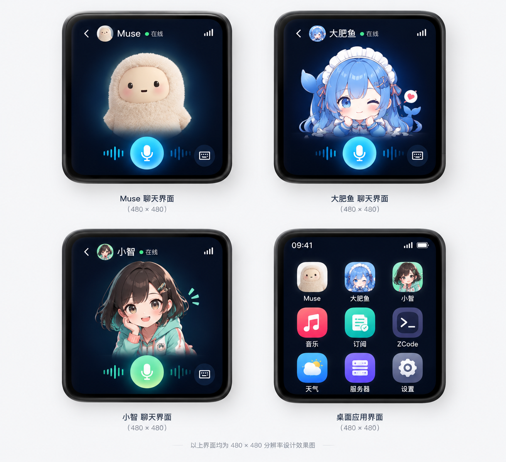

# Waveshare ESP32-S3 33969 AI Gadget

基于 [Waveshare ESP32-S3-Touch-AMOLED-2.16（SKU 33969）](https://www.waveshare.com/esp32-s3-touch-amoled-2.16.htm)
的社区定制多应用 AI Gadget。非 Waveshare 官方固件。



> **UI 风格基准**（2026-11-14 定稿，不可变更）：三 AI 对话页
> （顶栏头像+在线点 / 中央角色形象 / 中央麦克风大按钮+左右波形）+
> 桌面 9 宫格（三 AI 形象头像 + 彩色符号磁贴）。设备端与 Web 端
> 所有界面均以本图为准；实现对齐项见 [docs/UI_DESIGN.md](docs/UI_DESIGN.md)。

> 完整规划见 [PLAN.md](PLAN.md)。硬件调研见 [docs/HARDWARE.md](docs/HARDWARE.md)，
> 系统架构见 [docs/ARCHITECTURE.md](docs/ARCHITECTURE.md)，
> 关键决策记录见 [docs/DECISIONS.md](docs/DECISIONS.md)，
> 电源管理方案见 [docs/POWER_MANAGEMENT.md](docs/POWER_MANAGEMENT.md)，
> 开发环境搭建见 [docs/DEVELOPMENT.md](docs/DEVELOPMENT.md)。
> 真机刷写与驱动验证手册见 [docs/BRINGUP.md](docs/BRINGUP.md)。

## 仓库结构

```text
waveshare-esp32-s3-33969-ai-gadget/
├── firmware/          # ESP32-S3 固件（ESP-IDF v6.0.x + LVGL，真机 bring-up 已完成）
│   └── components/power_manager/   # AXP2101 电池/充电 + 轮询策略 + 充电屏保钩子
├── bridge/            # Go Bridge：额度/凭据/AI 路由/语音（ASR/LLM/TTS、音色试听）
├── web/               # Vue 3 管理后台（总览 + 12 个配置页，手机/PC 响应式）
├── simulator/lvgl-pc/ # LVGL PC 模拟器（480×480，主 UI 开发环境，含中文字体子集）
│   └── assets/icons/  # 桌面应用图标（自备素材 + 缺位回退）
├── assets/            # 设计素材（概念图、吉祥物，非官方资产）
├── docs/              # 硬件、架构、决策、开发、bring-up、小智协议调研
├── scripts/           # check.sh 全仓检查 / gen_cn_font.sh 字体子集 等
└── PLAN.md            # 项目总规划
```

## 使用说明

### 1. 启动 Bridge 和 Web 后台（Mac）

```bash
cd bridge
go build -o gadget-bridge ./cmd/gadget-bridge   # 首次或更新后
./run.sh                                        # :8081（读 bridge.env）
cd ../web && npm install && npm run dev         # :5173
```

- `bridge.env`（gitignore）里放 `BRIDGE_MASTER_KEY`（64 位 hex）；没有它凭据无法加密落库。
- 运行日志在 `/tmp/bridge.log`；Web/Bridge 改配置即时生效，不用重启设备。
- 设备只连 Bridge（`http://<Mac IP>:8081`），不直接连 Web。

### 2. 配置设备 Wi-Fi 与 Bridge 地址（编译期）

当前固件不做运行期配网，Wi-Fi 和 Bridge 地址写在 `firmware/main/wifi_secret.h`：

```c
#define WIFI_SSID "your-2.4g-ssid"                 // 仅支持 2.4GHz
#define WIFI_PASS "your-password"
#define BRIDGE_HOST "http://192.168.0.100:8081"    // Mac 的局域网 IP
```

- 复制 `wifi_secret.h.example` 为 `wifi_secret.h`（已 gitignore），改完重新 `idf.py build flash`。
- Mac 的 IP 变了设备就连不上 Bridge：建议在路由器给 Mac 做 DHCP 保留，或改头文件重刷。
- Web 的「网络与配网」页目前是流程设计/演示（mock），真机运行期配网尚未实现。

### 3. 刷写固件

```bash
pkill -9 -f esp-idf-monitor      # 否则串口被占用，刷写必失败
cd firmware
idf.py build
idf.py -p /dev/cu.usbmodem1101 flash
```

首次刷写前必须有原厂全片备份（见 [BRINGUP.md §1.0](docs/BRINGUP.md)）。
ESP-IDF 环境见 [DEVELOPMENT.md](docs/DEVELOPMENT.md)。

### 4. 设备日常使用

- 首页左右滑翻页，底部小圆点跟随；一屏 4 个 App，排布可在 Web「外观」里改。
- **AstrBot 对话**：点页面标题弹「选择机器人」，选中的实例决定文字与语音回复；
  Web 的 AstrBot 页也能「设为当前」。
- **语音**：按住底部麦克风说话，松开后依次显示 听 → 想 → 说，回复会朗读。
  转写 Key 与每个 App 的音色在 Web「语音设置」，每个音色旁可「▶ 试听」。
- **订阅中心**：设备订阅页显示 Web「订阅中心」配置的订阅实例
  （类型 + 名称 + API Key，选类型自动填官方端点）。
- **小智**：在 Web「小智」页点「连接官方服务」，把 6 位激活码输入
  xiaozhi.me 控制台绑定后，设备小智 App 的转写、人设与音色全走官方
  （人设/音色在官方控制台配）。未绑定或官方服务失败时自动回落本机
  语音链路（语音设置页的音色此时生效）。
- 设置页里有后台/配网二维码，扫码可在局域网打开 Web 后台。

### 5. 能拔 USB 线吗？

- **设备**：USB 只负责供电/串口日志，联网走 Wi-Fi。板子接了电池（或换充电器
  供电）就能拔线独立运行；**没接电池拔线即断电**。
- **AI 功能**：回复要经过 Mac 上的 Bridge。Mac 关机/睡眠、Bridge 没起、或不在
  同一 Wi-Fi，设备能开机但对话会失败。
- 刷机、看串口日志时必须接 USB。

### 6. 局域网打开后台

Bridge 监听 `:8081` 全部网卡；Web 开发服务器已设 `host: true`：

```bash
ipconfig getifaddr en0        # 取 Mac 局域网 IP（例如 192.168.0.23）
# 手机/另一台电脑浏览器打开 http://192.168.0.23:5173
```

- **只在可信局域网使用**：后台可以改凭据、机器人配置。
- 首次访问若被拦，在「系统设置 → 网络 → 防火墙」放行 node。
- 若设置了 `BRIDGE_TOKEN`，在浏览器控制台执行
  `localStorage.setItem('bridge_token','<token>')` 后刷新（暂无登录页）。

### 7. 常见问题

| 现象 | 处理 |
|------|------|
| 设备订阅页是空的 | Web「订阅中心」添加订阅实例（类型+名称+API Key）——实例才是设备显示的卡片；未建实例时设备显示"请添加订阅" |
| 设备对话一直失败 | Mac IP 变了或 Bridge 没起：`curl http://<MacIP>:8081/api/v1/device/status`；必要时改 `wifi_secret.h` 重刷 |
| 有文字没声音 | 设备音量/静音；或 TTS Key 没配（Web 语音设置页看「当前生效」）|
| 说话后卡「思考中」 | 看 `/tmp/bridge.log` 的 `voice:` 分段耗时；确认 Bridge 在跑 |
| 设备偶尔自动重启一次 | 启动期显示管线楔死，任务看门狗约 20s 自动恢复；连续发生再看串口日志 |
| 长按电源键关机 | 长按约 2s 优雅关机（灭屏即反馈）；**插着 USB 时关机后可能立即重新开机**（VBUS 触发上电，硬件行为）——拔掉 USB 再关或用电池状态关机。固件卡死时长按 10s 硬关兜底 |
| 中文显示方块 | 字体过期：`scripts/gen_cn_font.sh` 后重刷 |
| 刷写失败 | 先 `pkill -9 -f esp-idf-monitor`，再确认 `/dev/cu.usbmodem*` |
| flash 余量告警 | app 分区只剩 5%（232KB）；加功能前先裁剪字体/素材 |

### 8. Muse 首次使用（必须先刷官方 SDK 配对）

Muse 的云端授权**不能在本固件里完成**，必须先走一次官方流程：

1. 确认原厂全片备份存在，然后刷**官方 Muse Gadget SDK 固件**
   （`sdkconfig.muse-waveshare-s3-216`，ESP-IDF v6.0.3）。
2. 手机 Muse App 配对设备并完成授权（设备屏出现 `setup=done ws=up` 即成功）。
3. 导出 NVS：`esptool read-flash 0x11000 0xC000 nvs.bin`，取出
   `access_token` / `refresh_token` / `node_id` / `noise_host`。
4. **刷回本项目固件**，并重烧伴宠资源分区（官方固件的 files 会覆盖
   `assets`，`scripts/flash_companion.sh`）。
5. Web「Muse」页填四项凭据 → 保存 →「连通性测试」。

凭据被 revoke/过期需要重做第 1–3 步。详细步骤与实测记录见
[docs/HARDWARE.md §2.9](docs/HARDWARE.md) 与 [ADR-004](docs/DECISIONS.md)。

## 开发与检查命令

```bash
scripts/check.sh    # bridge go vet/build/test + web typecheck + simulator cmake + firmware idf.py build

# LVGL PC 模拟器（UI 主开发环境）
brew install sdl2
cmake -S simulator/lvgl-pc -B simulator/lvgl-pc/build
cmake --build simulator/lvgl-pc/build -j
./simulator/lvgl-pc/build/gadget_sim            # mock 数据源
GADGET_DS=bridge GADGET_BRIDGE=http://127.0.0.1:8081 \
    ./simulator/lvgl-pc/build/gadget_sim        # 连真 Bridge
# headless 回归钩子：GADGET_SNAP / DEMO_APP / DEMO_PAGE / DEMO_KEYS

# 中文字体（改字典/加字后必须重新生成）
scripts/gen_cn_font.sh
```

## 状态（2026-11-16）

| 模块 | 状态 |
|------|------|
| 真机 bring-up（Phase 6 前半） | ✅ 全外设验证通过：I2C×6 / 显示 / 触摸 / 音频双向 / TF / RTC / AXP2101 真读数 / Wi-Fi→Bridge / 充电屏保 |
| 模拟器 UI | ✅ Launcher（多页/页点/图标）+ AstrBot 对话 / 小智 / 天气 / 额度 / 监控 / 订阅 / 外观 / 按键映射 |
| Bridge | ✅ 额度 + 凭据 + 订阅 + AstrBot 多实例（当前实例切换）+ 天气 + Komari + 按键/排布 + 外观 + events(WS) + 语音链路（ASR/LLM/TTS、音色试听） |
| Web 后台 | ✅ 总览 + 12 个配置页：外观/网络与配网/代理/按键/订阅中心/AstrBot/语音设置/Muse/小智/ZCode/监控/天气 |
| 固件 UI 移植（Phase 6 后半） | ✅ 主体已在真机运行（launcher/对话/设置/订阅/天气；共享模拟器源码） |
| 稳定性（2026-11-15 收敛） | ✅ 绘制缓冲内部 RAM + 语音静态栈任务 + LVGL 心跳看门狗；连续 6 轮完整语音回合零 NO_MEM/panic |
| 小智官方服务（xiaozhi.me） | ✅ 已接入并真网验证：Bridge 模拟设备（OTA 激活 + WebSocket + Opus，官方 TTS 直通），未绑定自动回落本机链路，见 [ADR-005](docs/DECISIONS.md) |
| 设备端 ZCode / 音乐 | ⏳ 规划中 |

里程碑与详细进度见 [docs/PROGRESS.md](docs/PROGRESS.md)。
所有未在真机验证的内容都在 docs 中以 TODO 标注，不声称已测试。

## 踩坑速查（改固件前先看）

| 坑 | 结论 |
|----|------|
| 绘制缓冲放 PSRAM | SPI 每块要在内部 RAM 分配同尺寸 bounce buffer，碎片化后必然失败 → 丢帧花屏 + flush 卡死。**现在固定内部 RAM 10 行双缓冲，别改回 PSRAM** |
| 语音线程动态栈 | 内部 RAM 碎片化时 12–16KB 栈 ENOMEM；栈放 PSRAM 会 `InstrFetchProhibited`。**用静态栈任务（.bss 14KB）** |
| 看门狗按「锁 BUSY」判 | 聊天页重绘慢时会误杀（心跳仍在推进）。**判据是 LVGL 心跳 15s 不推进**；TWDT 10s 自愈 |
| 字体压缩/回退 | `gen_cn_font.sh` 默认 RLE 压缩，必须开 `LV_USE_FONT_COMPRESSED`，否则空心方块；生成器自带 `.fallback = NULL` 会覆盖挂接。**当前不压缩、无 L2 回退，flash 余 5%** |
| 桌面重建 | `ui_launcher_rebuild` 前必须清页点数组（悬垂指针会 LoadProhibited）；波浪背景 buffer 要复用 |
| 开机拉远端配置 | Wi-Fi 未起时拉不到；`remote_cfg_task` 两段式：prefetch（不持锁）→ refresh（持锁应用+重建） |
| ES7210 按轮启停采集 | 播放期间无人读 mic → RX DMA 溢出后读数恒为零（转写永远同一句、rc=0 无报错）。**采集任务常驻，别按轮启停** |
| 主任务直发 QSPI 命令 | 背光 `tx_param` 与 LVGL 首帧 DMA 并发会撑死总线断言（实测 125s 后崩溃）。**发 polling 事务必须持 display_lock** |
| Bridge 重启 | 必须带同一个 `BRIDGE_MASTER_KEY`，否则凭据无法解密；开发机日志 `/tmp/bridge.log` |
| 局域网后台 | Bridge 监听 `:8081` 全部网卡；Vite 已 `host: true`；设备只连 Bridge，不连 Web |

完整记录见 [AGENTS.md「稳定性踩坑」](AGENTS.md) 与 [docs/HARDWARE.md §2.10](docs/HARDWARE.md)。

## 安全原则

- API Key / Cookie / OAuth Token 永不进入固件、日志、Git 和二维码。
- 供应商凭据与 AstrBot token 只保存在 Go Bridge（AES-256-GCM 落库、不回显）。
- 供应商订阅额度接口按可信度分级（A/B/C/D），未公开接口默认关闭。
- 原厂固件闭源且不可找回——**刷写前必须全片备份**（见 BRINGUP.md §1.0）。
